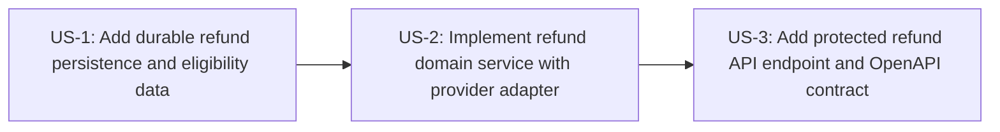

# Plan: Curated Intent (INT-2)

Project type: brownfield. Stories are built one at a time, in this order. Knowledge graph: consulted.

## Order

| # | Story | Repo | Risk | Depends on | Protected contract |
| --- | --- | --- | --- | --- | --- |
| 1 | US-1: Add durable refund persistence and eligibility data | `SanjulikaSthirAI/orders-api` | high | - | yes |
| 2 | US-2: Implement refund domain service with provider adapter | `SanjulikaSthirAI/orders-api` | high | US-1 | yes |
| 3 | US-3: Add protected refund API endpoint and OpenAPI contract | `SanjulikaSthirAI/orders-api` | high | US-2 | yes |

## Dependencies

## Stories

### 1. US-1: Add durable refund persistence and eligibility data

- **Repo:** `SanjulikaSthirAI/orders-api`
- **Requirements:** FR-1, FR-2, FR-4, FR-6, FR-8, FR-9; TDD sections 2.1, 4, 5, 6, 9
- **Risk:** high (changes a protected contract)
- **Depends on:** nothing
- **Touches:** `app/store.py`, `app/**/migrations/**`, `adr/0001-use-sqlite-for-orders-persistence-when-no-durable-store-exis.md`, `tests/**`
- **Provides:** -; **consumes:** -

Extend the orders API persistence boundary so refund state, idempotency records, audit records, and internal refund eligibility data can be stored durably with orders, including migration/backfill behavior for recent historical orders. Do not expose internal eligibility or refund state on existing order API responses.

Acceptance criteria:
- AC-1.3: Given an otherwise Eligible refund request for an Order placed before this feature went live and within the last 30 days, when Support staff requests a Refund, then the orders API allows the Refund.
- AC-8.2: Given a Refund request with a new idempotency key or request ID, when the request is processed, then the orders API records the key or request ID with the request details and outcome for at least 30 days.
- AC-9.4: Given Support staff uses the orders API in the first version, when they look for Refund audit/history retrieval, then the orders API provides no Refund audit/history retrieval capability.

| Test | Verifies | Type | Inputs | Expected |
| --- | --- | --- | --- | --- |
| TC-1.1 historical_recent_order_created_before_feature_go_live_is_refundable | AC-1.3 | integration | order_created_before_feature_go_live=true, order_age_days=10, otherwise_eligible=true, support_has_refund_permission=true, idempotency_key=hist-recent-001 | refund request is allowed and proceeds as eligible; no rejection due to pre-feature-go-live placement |
| TC-1.2 new_idempotency_key_is_persisted_with_request_details_outcome_and_retention | AC-8.2 | integration | idempotency_key=idem-new-001, order_id=eligible-order-001, request_details=empty_body_full_order_refund, outcome=success, processed_at=2026-01-01T12:00:00Z | idempotency record is stored with key, order_id, request details, success outcome, and retention/expires_at at least 30 days after processed_at |
|  |  |  | idempotency_key=idem-new-002, order_id=ineligible-order-001, request_details=empty_body_full_order_refund, outcome=order_not_refundable_or_not_found, processed_at=2026-01-01T12:00:00Z | idempotency record is stored with key, order_id, request details, failure outcome, and retention/expires_at at least 30 days after processed_at |
| TC-1.3 first_version_exposes_no_refund_audit_history_retrieval_api | AC-9.4 | contract | api_contract=openapi, searched_paths=/refund-audit,/refund-history,/orders/{order_id}/refund-history,/orders/{order_id}/refunds/history | no refund audit/history retrieval endpoint is present in the orders API contract |

### 2. US-2: Implement refund domain service with provider adapter

- **Repo:** `SanjulikaSthirAI/orders-api`
- **Requirements:** FR-1, FR-2, FR-3, FR-4, FR-6, FR-7, FR-8, FR-9; TDD sections 2.1, 4, 5, 6, 7, 9
- **Risk:** high (changes a protected contract)
- **Depends on:** US-1
- **Touches:** `app/store.py`, `app/**/refund*.py`, `app/**/payment*.py`, `tests/**`
- **Provides:** -; **consumes:** -

Implement the refund service logic behind the API using an injected deterministic provider adapter, server-time clock injection, eligibility evaluation, order-scoped locking, duplicate prevention, provider failure handling, same-key recovery, and internal audit/history writes.

Acceptance criteria:
- AC-1.1: Given Support staff with the required refund permission or role, a Recent order, a successfully captured external cash or card payment, no prior Refund, no Refund already being processed, no chargeback, no payment dispute, no payment reversal, and a new idempotency key or request ID, when the Support staff member requests a Refund through the orders API, then the orders API initiates a Full-order refund for the full paid Order total exactly as captured on the original Order.
- AC-1.2: Given an otherwise Eligible refund request for an Order placed exactly 30×24 hours before the Refund request time, when Support staff requests a Refund, then the orders API treats the Order as a Recent order.
- AC-2.1: Given the payment provider accepts or initiates a Refund, when the orders API completes the Refund request, then the Order is marked as refunded with a refund timestamp and refund amount.
- AC-2.3: Given a successful Refund, when the refund timestamp is recorded, then the timestamp is based on server/system time.
- AC-3.1: Given Support staff requests a Refund for an Order placed more than a rolling 30×24-hour period before the Refund request time, when the Order is not already refunded and no Refund is already being processed for the Order, then the orders API rejects the request with an “order older than 30 days” error.
- AC-3.2: Given any Refund request, when the orders API evaluates whether the Order is a Recent order, then the evaluation uses server/system time and the exact Order placement timestamp.
- AC-4.1: Given an Order is already marked as refunded, when Support staff requests a Refund for that Order, then the orders API rejects the request with an “order already refunded” error.
- AC-4.2: Given an Order is both already marked as refunded and older than 30 days, when Support staff requests a Refund for that Order, then the orders API rejects the request with an “order already refunded” error.
- AC-4.3: Given two Refund requests for the same eligible Order with different idempotency keys are made at nearly the same time, when the requests are processed, then exactly one Refund is initiated and the other request is rejected with a “refund already in progress” error while the first Refund is still processing.
- AC-4.4: Given a Refund is already being processed for an Order, when Support staff requests another Refund for that Order, then the orders API rejects the request with a “refund already in progress” error.
- AC-4.5: Given an Order has a Refund already being processed and also has another eligibility issue, when Support staff requests a Refund for that Order, then the orders API rejects the request with a “refund already in progress” error.
- AC-4.6: Given a money Refund has been initiated but the Order has not been marked as refunded due to a later failure, when Support staff retries the same Refund request and the existing Refund details are available, then the orders API does not issue a second money Refund and marks the Order as refunded with the existing Refund details.
- AC-6.1: Given a Refund request for an Order that is not found, when the request is processed, then the orders API rejects the request with an “order not refundable or not found” error.
- AC-6.2: Given a Refund request for an Order with unpaid, cancelled-before-payment, failed-payment, or pending-payment status, when the request is processed, then the orders API rejects the request with an “order not refundable or not found” error.
- AC-6.3: Given a Refund request for an Order that does not have a successfully captured external cash or card payment, when the request is processed, then the orders API rejects the request with an “order not refundable or not found” error.
- AC-6.4: Given a Refund request for an Order with more than one successful external payment capture, when the request is processed, then the orders API rejects the request with an “order not refundable or not found” error.
- AC-6.5: Given a Refund request for an Order with a previous refund that was not a Full-order refund, chargeback, payment dispute, or payment reversal, when the request is processed, then the orders API rejects the request with an “order not refundable or not found” error.
- AC-6.6: Given a Refund request for a fulfilled, shipped, or delivered Order that is otherwise an Eligible refund request, when the request is processed, then the orders API does not reject the request because the Order is fulfilled, shipped, or delivered.
- AC-7.1: Given an otherwise Eligible refund request, when the payment provider refuses or fails the Refund attempt, then the orders API rejects the request with a “refund payment failed” error.
- AC-7.2: Given the payment provider refuses or fails the Refund attempt, when the Refund request ends, then the Order is not marked as refunded.
- AC-8.2: Given a Refund request with a new idempotency key or request ID, when the request is processed, then the orders API records the key or request ID with the request details and outcome for at least 30 days.
- AC-8.3: Given a repeated Refund request with the same idempotency key or request ID and the same request details after the original outcome is known, when the request is processed within the idempotency record retention period, then the orders API returns the original outcome.
- AC-8.4: Given a repeated Refund request with the same idempotency key or request ID while the original request is still processing, when the request is processed, then the orders API returns a “refund already in progress” error until the original outcome is known.
- AC-8.5: Given a Refund request reuses an idempotency key or request ID for a different Order or different Refund request details, when the request is processed, then the orders API rejects the request with an “idempotency key conflict” error.
- AC-9.1: Given a successful Refund, when the request completes, then the system records the requesting Support staff member and request timestamp internally.
- AC-9.2: Given a failed Refund attempt, when the request completes, then the system records the requesting Support staff member, request timestamp, Order ID, and failure category internally.
- AC-9.3: Given any Refund audit/history timestamp is recorded, when the timestamp is set, then it uses server/system time.

| Test | Verifies | Type | Inputs | Expected |
| --- | --- | --- | --- | --- |
| TC-2.1 eligible_refund_initiates_full_order_refund_for_exact_captured_total | AC-1.1 | integration | support_has_refund_permission=true, order_age_hours=24, payment_type=external_card, payment_status=captured, captured_total=123.45, prior_refund=false, refund_in_progress=false, chargeback=false, dispute=false, reversal=false, idempotency_key=eligible-001 | provider refund is initiated exactly once for full amount 123.45 and order currency from original capture |
| TC-2.2 refund_window_includes_exactly_30_days_using_server_time_and_order_timestamp | AC-1.2, AC-3.2 | unit | server_time=2026-02-01T12:00:00Z, order_placed_at=2026-01-02T12:00:00Z, otherwise_eligible=true | order is treated as Recent and refund is allowed |
| TC-2.3 accepted_provider_refund_marks_order_refunded_with_server_time_and_amount | AC-2.1, AC-2.3 | integration | server_time=2026-02-01T12:00:00Z, captured_total=80.00, provider_result=accepted, idempotency_key=mark-001 | order is marked refunded with refund_timestamp=2026-02-01T12:00:00Z and refund_amount=80.00 |
| TC-2.4 refund_window_rejects_order_older_than_rolling_30_days | AC-3.1, AC-3.2 | unit | server_time=2026-02-01T12:00:00Z, order_placed_at=2026-01-02T11:59:59Z, already_refunded=false, refund_in_progress=false | request is rejected with error=order older than 30 days |
| TC-2.5 already_refunded_order_is_rejected | AC-4.1 | unit | already_refunded=true, order_age_days=5, refund_in_progress=false, idempotency_key=dup-001 | request is rejected with error=order already refunded |
| TC-2.6 already_refunded_takes_precedence_over_order_age_error | AC-4.2 | unit | already_refunded=true, order_age_days=31, refund_in_progress=false, idempotency_key=dup-old-001 | request is rejected with error=order already refunded |
| TC-2.7 concurrent_refunds_with_different_keys_initiate_only_one_provider_refund | AC-4.3 | integration | same_order=eligible-order-001, request_a_idempotency_key=concurrent-a, request_b_idempotency_key=concurrent-b, provider_processing=held_open | exactly one request initiates provider refund; the other is rejected with error=refund already in progress while first is processing |
| TC-2.8 refund_in_progress_order_is_rejected | AC-4.4 | unit | refund_in_progress=true, already_refunded=false, otherwise_eligible=true, idempotency_key=inprogress-001 | request is rejected with error=refund already in progress |
| TC-2.9 refund_in_progress_takes_precedence_over_other_eligibility_issues | AC-4.5 | unit | refund_in_progress=true, order_age_days=31, already_refunded=false, idempotency_key=inprogress-old-001 | request is rejected with error=refund already in progress |
|  |  |  | refund_in_progress=true, payment_status=failed, already_refunded=false, idempotency_key=inprogress-failedpay-001 | request is rejected with error=refund already in progress |
| TC-2.10 same_request_retry_after_money_refund_initiated_recovers_without_second_provider_refund | AC-4.6 | integration | idempotency_key=recover-001, existing_provider_refund_id=pr_123, existing_refund_amount=55.00, order_marked_refunded=false, existing_refund_details_available=true | no second provider refund is issued; order is marked refunded using existing refund details pr_123 amount 55.00 |
| TC-2.11 missing_order_is_not_refundable_or_not_found | AC-6.1 | unit | order_exists=false, idempotency_key=missing-001 | request is rejected with error=order not refundable or not found |
| TC-2.12 unpaid_or_unsuccessful_payment_statuses_are_not_refundable | AC-6.2 | unit | order_payment_status=unpaid, idempotency_key=status-unpaid | request is rejected with error=order not refundable or not found |
|  |  |  | order_payment_status=cancelled_before_payment, idempotency_key=status-cancelled | request is rejected with error=order not refundable or not found |
|  |  |  | order_payment_status=failed_payment, idempotency_key=status-failed | request is rejected with error=order not refundable or not found |
|  |  |  | order_payment_status=pending_payment, idempotency_key=status-pending | request is rejected with error=order not refundable or not found |
| TC-2.13 non_external_cash_or_card_payments_are_not_refundable | AC-6.3 | unit | payment_method=store_credit, payment_status=captured, idempotency_key=tender-store-credit | request is rejected with error=order not refundable or not found |
|  |  |  | payment_method=gift_card, payment_status=captured, idempotency_key=tender-gift-card | request is rejected with error=order not refundable or not found |
|  |  |  | payment_method=promo_credit, payment_status=captured, idempotency_key=tender-promo-credit | request is rejected with error=order not refundable or not found |
|  |  |  | payment_method=mixed_tender, payment_status=captured, idempotency_key=tender-mixed | request is rejected with error=order not refundable or not found |
| TC-2.14 multiple_successful_external_captures_are_not_refundable | AC-6.4 | unit | successful_external_capture_count=2, payment_method=external_card, idempotency_key=multi-capture-001 | request is rejected with error=order not refundable or not found |
| TC-2.15 previous_non_full_refund_chargeback_dispute_or_reversal_are_not_refundable | AC-6.5 | unit | previous_refund_type=partial_refund, idempotency_key=prev-partial | request is rejected with error=order not refundable or not found |
|  |  |  | previous_refund_type=chargeback, idempotency_key=prev-chargeback | request is rejected with error=order not refundable or not found |
|  |  |  | previous_refund_type=payment_dispute, idempotency_key=prev-dispute | request is rejected with error=order not refundable or not found |
|  |  |  | previous_refund_type=payment_reversal, idempotency_key=prev-reversal | request is rejected with error=order not refundable or not found |
| TC-2.16 fulfilled_shipped_or_delivered_status_does_not_block_otherwise_eligible_refund | AC-6.6 | unit | fulfillment_status=fulfilled, otherwise_eligible=true, idempotency_key=fulfill-001 | request is not rejected due to fulfillment status and refund proceeds |
|  |  |  | fulfillment_status=shipped, otherwise_eligible=true, idempotency_key=ship-001 | request is not rejected due to fulfillment status and refund proceeds |
|  |  |  | fulfillment_status=delivered, otherwise_eligible=true, idempotency_key=deliver-001 | request is not rejected due to fulfillment status and refund proceeds |
| TC-2.17 provider_failure_returns_payment_failed_and_does_not_mark_refunded | AC-7.1, AC-7.2 | integration | otherwise_eligible=true, provider_result=refused, idempotency_key=provider-refused-001 | request is rejected with error=refund payment failed and order remains not refunded |
|  |  |  | otherwise_eligible=true, provider_result=failed, idempotency_key=provider-failed-001 | request is rejected with error=refund payment failed and order remains not refunded |
| TC-2.18 new_idempotency_key_records_details_outcome_and_minimum_30_day_retention | AC-8.2 | integration | idempotency_key=svc-idem-001, order_id=eligible-order-002, outcome=success, server_time=2026-02-01T12:00:00Z | idempotency record stores key, order_id, request details, success outcome, and retention through at least 2026-03-03T12:00:00Z |
| TC-2.19 same_key_same_details_returns_original_known_outcome_within_retention | AC-8.3 | integration | idempotency_key=repeat-success-001, same_order=true, same_request_details=true, original_outcome=success, within_retention=true | retry returns the original success outcome and does not initiate another provider refund |
|  |  |  | idempotency_key=repeat-failure-001, same_order=true, same_request_details=true, original_outcome=refund payment failed, within_retention=true | retry returns the original failure outcome and does not initiate another provider refund |
| TC-2.20 same_key_retry_while_original_processing_returns_in_progress | AC-8.4 | integration | idempotency_key=repeat-processing-001, same_order=true, same_request_details=true, original_request_state=processing | retry is rejected with error=refund already in progress until original outcome is known |
| TC-2.21 same_idempotency_key_with_different_order_or_details_is_conflict | AC-8.5 | unit | idempotency_key=conflict-001, original_order_id=order-1, retry_order_id=order-2, same_request_details=true | request is rejected with error=idempotency key conflict |
|  |  |  | idempotency_key=conflict-002, original_order_id=order-1, retry_order_id=order-1, same_request_details=false | request is rejected with error=idempotency key conflict |
| TC-2.22 successful_refund_audit_records_staff_member_and_server_request_timestamp | AC-9.1, AC-9.3 | integration | support_staff_id=support-123, server_time=2026-02-01T12:00:00Z, outcome=success, idempotency_key=audit-success-001 | audit record contains support_staff_id=support-123 and request_timestamp=2026-02-01T12:00:00Z |
| TC-2.23 failed_refund_audit_records_staff_timestamp_order_and_failure_category | AC-9.2, AC-9.3 | integration | support_staff_id=support-456, order_id=order-fail-001, server_time=2026-02-01T12:00:00Z, failure_category=refund payment failed, idempotency_key=audit-fail-001 | audit record contains support_staff_id=support-456, request_timestamp=2026-02-01T12:00:00Z, order_id=order-fail-001, failure_category=refund payment failed |

### 3. US-3: Add protected refund API endpoint and OpenAPI contract

- **Repo:** `SanjulikaSthirAI/orders-api`
- **Requirements:** FR-1, FR-2, FR-5, FR-8, FR-9; TDD sections 2.1, 3, 5, 9
- **Risk:** high (changes a protected contract)
- **Depends on:** US-2
- **Touches:** `app/main.py`, `app/models.py`, `openapi.yaml`, `tests/**`
- **Provides:** `POST /orders/{order_id}/refunds`; **consumes:** -

Add POST /orders/{order_id}/refunds with authentication, refund:orders authorization, required Idempotency-Key header, empty request body, minimal success response, declared error mapping, and regenerated OpenAPI contract. Existing endpoints remain unchanged.

Acceptance criteria:
- AC-2.2: Given a successful Refund, when the orders API returns the success response, then the response includes the refund timestamp and refund amount.
- AC-5.1: Given Support staff without the required refund permission or role, when they request a Refund, then the orders API rejects the request with a “not authorized to refund” error.
- AC-5.2: Given Support staff has the required refund permission or role but cannot access the referenced Order, when they request a Refund, then the orders API rejects the request with an “order not refundable or not found” error.
- AC-8.1: Given a Refund request without an idempotency key or request ID, when the request is processed, then the orders API rejects the request.
- AC-9.4: Given Support staff uses the orders API in the first version, when they look for Refund audit/history retrieval, then the orders API provides no Refund audit/history retrieval capability.

| Test | Verifies | Type | Inputs | Expected |
| --- | --- | --- | --- | --- |
| TC-3.1 successful_refund_response_includes_refund_timestamp_and_amount | AC-2.2 | contract | POST /orders/{order_id}/refunds, authorized=true, Idempotency-Key=api-success-001, service_result=success(refund_timestamp=2026-02-01T12:00:00Z, refund_amount=123.45) | HTTP success response body includes refund_timestamp=2026-02-01T12:00:00Z and refund_amount=123.45 |
| TC-3.2 support_without_refund_permission_is_rejected | AC-5.1 | integration | POST /orders/order-001/refunds, authenticated_support=true, has_refund_permission=false, Idempotency-Key=noauth-001 | request is rejected with error=not authorized to refund |
| TC-3.3 authorized_support_without_order_access_gets_not_refundable_or_not_found | AC-5.2 | integration | POST /orders/restricted-order/refunds, authenticated_support=true, has_refund_permission=true, can_access_order=false, Idempotency-Key=noaccess-001 | request is rejected with error=order not refundable or not found |
| TC-3.4 refund_endpoint_requires_idempotency_key_header | AC-8.1 | contract | POST /orders/order-001/refunds, authenticated_support=true, has_refund_permission=true, Idempotency-Key missing | request is rejected because idempotency key or request ID is required |
| TC-3.5 openapi_has_no_refund_audit_history_retrieval_endpoint | AC-9.4 | contract | api_contract=openapi, searched_methods=GET, searched_resources=refund audit/history retrieval endpoints | no endpoint exists for retrieving refund audit/history in first-version orders API |
