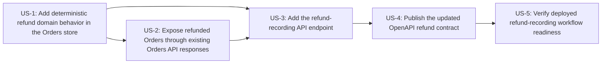

# Plan: Curated Intent (INT-3)

Project type: brownfield. Stories are built one at a time, in this order. Knowledge graph: consulted.

## Order

| # | Story | Repo | Risk | Depends on | Protected contract |
| --- | --- | --- | --- | --- | --- |
| 1 | US-1: Add deterministic refund domain behavior in the Orders store | `SanjulikaSthirAI/orders-api` | medium | - | no |
| 2 | US-2: Expose refunded Orders through existing Orders API responses | `SanjulikaSthirAI/orders-api` | high | US-1 | yes |
| 3 | US-3: Add the refund-recording API endpoint | `SanjulikaSthirAI/orders-api` | high | US-1, US-2 | yes |
| 4 | US-4: Publish the updated OpenAPI refund contract | `SanjulikaSthirAI/orders-api` | high | US-3 | yes |
| 5 | US-5: Verify deployed refund-recording workflow readiness | `SanjulikaSthirAI/orders-api` | low | US-4 | no |

## Dependencies

## Stories

### 1. US-1: Add deterministic refund domain behavior in the Orders store

- **Repo:** `SanjulikaSthirAI/orders-api`
- **Requirements:** FR-1, FR-2, FR-3, FR-4, FR-5, FR-6, FR-7, FR-8; TDD sections 2.1, 4, 5, 7, 9
- **Risk:** medium
- **Depends on:** nothing
- **Touches:** `app/store.py`, `app/models.py`, `tests/**`
- **Provides:** -; **consumes:** -

Implement refund-recording behavior in the store/service layer with injected UTC clock support, recording full Refunds on the existing Order representation without adding a new persistent store or payment-provider integration.

Acceptance criteria:
- AC-1.1: Given a support user with the existing appropriate Orders API access and an Order that was created after the cutoff exactly 30 days before the Refund time, is not already refunded, and is not a Cancelled order, when the support user records a Refund for the Order by order ID, then the Orders API records the Refund and returns the updated Order exposed as `refunded` with the Refund time.
- AC-1.2: Given a support user with the existing appropriate Orders API access and an Order that was created exactly at the cutoff 30 days before the Refund time, is not already refunded, and is not a Cancelled order, when the support user records a Refund for the Order by order ID, then the Orders API records the Refund and returns the updated Order exposed as `refunded` with the Refund time.
- AC-2.3: Given a Refund is accepted for an Order, when the Orders API records the Refund, then the Refund time exposed on the Order is set by the Orders API at acceptance time and is not supplied by the support user.
- AC-3.1: Given an existing Order is already refunded, when a support user with the existing appropriate Orders API access attempts to record a Refund for that Order by order ID, then the Orders API does not record another Refund and returns reason code `ORDER_ALREADY_REFUNDED` with a non-empty human-readable message.
- AC-4.1: Given an existing Order is a Cancelled order and is not already refunded, when a support user with the existing appropriate Orders API access attempts to record a Refund for that Order by order ID, then the Orders API does not record a Refund and returns reason code `ORDER_CANCELLED` with a non-empty human-readable message.
- AC-5.1: Given an existing Order was created before the cutoff exactly 30 days before the Refund time, is not already refunded, and is not a Cancelled order, when a support user with the existing appropriate Orders API access attempts to record a Refund for that Order by order ID, then the Orders API does not record a Refund and returns reason code `ORDER_TOO_OLD` with a non-empty human-readable message.
- AC-5.2: Given an existing Order was created at or after the cutoff exactly 30 days before the Refund time in UTC, is not already refunded, and is not a Cancelled order, when a support user with the existing appropriate Orders API access records a Refund for that Order by order ID, then the Orders API records the Refund and returns the updated Order exposed as `refunded` with the Refund time.
- AC-6.1: Given an existing Order is already refunded and is also a Cancelled order, when a support user with the existing appropriate Orders API access attempts to record a Refund for that Order by order ID, then the Orders API returns reason code `ORDER_ALREADY_REFUNDED` with a non-empty human-readable message.
- AC-6.2: Given an existing Order is already refunded and was created before the cutoff exactly 30 days before the Refund time, when a support user with the existing appropriate Orders API access attempts to record a Refund for that Order by order ID, then the Orders API returns reason code `ORDER_ALREADY_REFUNDED` with a non-empty human-readable message.
- AC-6.3: Given an existing Order is a Cancelled order, is not already refunded, and was created before the cutoff exactly 30 days before the Refund time, when a support user with the existing appropriate Orders API access attempts to record a Refund for that Order by order ID, then the Orders API returns reason code `ORDER_CANCELLED` with a non-empty human-readable message.
- AC-7.1: Given no Order exists for the provided order ID, when a support user with the existing appropriate Orders API access attempts to record a Refund for that order ID, then the Orders API does not record a Refund and returns reason code `ORDER_NOT_FOUND` with a non-empty human-readable message.
- AC-8.1: Given a support user with the existing appropriate Orders API access attempts to record less than a full Refund for an Order by order ID, when the request is processed, then the Orders API does not record a partial Refund.

| Test | Verifies | Type | Inputs | Expected |
| --- | --- | --- | --- | --- |
| TC-1.1 records_refund_for_order_created_after_utc_cutoff | AC-1.1 | unit | now_utc=2025-01-31T12:00:00Z, order_id=ord-after, order_created_at=2025-01-02T12:00:00Z, order_status=open, already_refunded=false, request_refund_time_supplied=false, refund_amount_supplied=none | success; order ord-after is exposed as refunded=true/status=refunded with refund_time=2025-01-31T12:00:00Z; exactly one full refund recorded; no payment-provider call |
| TC-1.2 records_refund_for_order_created_exactly_at_utc_cutoff | AC-1.2 | unit | now_utc=2025-01-31T12:00:00Z, order_id=ord-cutoff, order_created_at=2025-01-01T12:00:00Z, order_status=open, already_refunded=false, request_refund_time_supplied=false, refund_amount_supplied=none | success; order ord-cutoff is exposed as refunded=true/status=refunded with refund_time=2025-01-31T12:00:00Z; exactly one full refund recorded |
| TC-1.3 uses_injected_acceptance_time_not_client_supplied_time | AC-2.3 | unit | now_utc=2025-01-31T12:00:00Z, order_id=ord-client-time, order_created_at=2025-01-15T00:00:00Z, order_status=open, already_refunded=false, request_refund_time_supplied=2025-01-20T00:00:00Z | success; exposed refund_time=2025-01-31T12:00:00Z; client-supplied refund time is ignored/not persisted |
| TC-1.4 rejects_existing_refunded_order_without_second_refund | AC-3.1 | unit | now_utc=2025-01-31T12:00:00Z, order_id=ord-refunded, order_created_at=2025-01-15T00:00:00Z, order_status=refunded, already_refunded=true, existing_refund_time=2025-01-20T00:00:00Z | not_allowed; reason_code=ORDER_ALREADY_REFUNDED; message is non-empty; no additional refund recorded; existing_refund_time remains 2025-01-20T00:00:00Z |
| TC-1.5 rejects_cancelled_order | AC-4.1 | unit | now_utc=2025-01-31T12:00:00Z, order_id=ord-cancelled, order_created_at=2025-01-15T00:00:00Z, order_status=cancelled, already_refunded=false | not_allowed; reason_code=ORDER_CANCELLED; message is non-empty; no refund recorded; order is not exposed as newly refunded |
| TC-1.6 rejects_order_created_before_utc_cutoff | AC-5.1 | unit | now_utc=2025-01-31T12:00:00Z, order_id=ord-too-old, order_created_at=2025-01-01T11:59:59Z, order_status=open, already_refunded=false | not_allowed; reason_code=ORDER_TOO_OLD; message is non-empty; no refund recorded; order is not exposed as refunded |
| TC-1.7 utc_cutoff_allows_at_and_after_boundary | AC-5.2 | unit | now_utc=2025-03-31T00:30:00Z, order_id=ord-utc-at, order_created_at=2025-03-01T00:30:00Z, order_status=open, already_refunded=false | success; order is exposed as refunded with refund_time=2025-03-31T00:30:00Z |
|  |  |  | now_utc=2025-03-31T00:30:00Z, order_id=ord-utc-after, order_created_at=2025-03-01T00:30:01Z, order_status=open, already_refunded=false | success; order is exposed as refunded with refund_time=2025-03-31T00:30:00Z |
| TC-1.8 already_refunded_reason_has_priority_over_cancelled | AC-6.1 | unit | now_utc=2025-01-31T12:00:00Z, order_id=ord-refunded-cancelled, order_created_at=2025-01-15T00:00:00Z, order_status=cancelled, already_refunded=true | not_allowed; reason_code=ORDER_ALREADY_REFUNDED; message is non-empty; no additional refund recorded |
| TC-1.9 already_refunded_reason_has_priority_over_too_old | AC-6.2 | unit | now_utc=2025-01-31T12:00:00Z, order_id=ord-refunded-old, order_created_at=2024-12-31T12:00:00Z, order_status=refunded, already_refunded=true | not_allowed; reason_code=ORDER_ALREADY_REFUNDED; message is non-empty; no additional refund recorded |
| TC-1.10 cancelled_reason_has_priority_over_too_old | AC-6.3 | unit | now_utc=2025-01-31T12:00:00Z, order_id=ord-cancelled-old, order_created_at=2024-12-31T12:00:00Z, order_status=cancelled, already_refunded=false | not_allowed; reason_code=ORDER_CANCELLED; message is non-empty; no refund recorded |
| TC-1.11 missing_order_returns_not_found_reason | AC-7.1 | unit | now_utc=2025-01-31T12:00:00Z, order_id=ord-missing, order_exists=false | not_allowed; reason_code=ORDER_NOT_FOUND; message is non-empty; no refund recorded |
| TC-1.12 rejects_partial_refund_request_without_recording_partial_refund | AC-8.1 | unit | now_utc=2025-01-31T12:00:00Z, order_id=ord-partial, order_created_at=2025-01-15T00:00:00Z, order_status=open, already_refunded=false, refund_amount_supplied=10.00, order_total=100.00 | request rejected/not recorded as partial refund; no refund recorded; order is not exposed as newly refunded |

### 2. US-2: Expose refunded Orders through existing Orders API responses

- **Repo:** `SanjulikaSthirAI/orders-api`
- **Requirements:** FR-2; TDD sections 2.1, 3, 4, 9
- **Risk:** high (changes a protected contract)
- **Depends on:** US-1
- **Touches:** `app/models.py`, `app/main.py`, `tests/**`
- **Provides:** `GET /orders`, `GET /orders/{order_id}`, `POST /orders`, `POST /orders/{order_id}/cancel`; **consumes:** -

Extend the Order response model and existing retrieval/list/create/cancel responses so refunded Orders are exposed as `refunded` with `refund_time`, while non-refunded Orders remain backward compatible and existing order actions gain no new restrictions.

Acceptance criteria:
- AC-2.1: Given a Refund has been recorded for an Order, when the refund-recording response is returned, then the response includes the updated Order exposed as `refunded` and includes the Refund time.
- AC-2.2: Given a Refund has been recorded for an Order, when the Order is retrieved afterward through the Orders API, then the retrieved Order is exposed as `refunded` and includes the Refund time.
- AC-2.3: Given a Refund is accepted for an Order, when the Orders API records the Refund, then the Refund time exposed on the Order is set by the Orders API at acceptance time and is not supplied by the support user.

| Test | Verifies | Type | Inputs | Expected |
| --- | --- | --- | --- | --- |
| TC-2.1 refund_recording_response_includes_refunded_order_and_refund_time | AC-2.1 | integration | support_user_authorized=true, now_utc=2025-01-31T12:00:00Z, order_id=ord-response, order_created_at=2025-01-15T00:00:00Z, POST /orders/{order_id}/refunds body={} | success response body includes updated order exposed as refunded=true/status=refunded and refund_time=2025-01-31T12:00:00Z |
| TC-2.2 retrieved_order_after_refund_is_exposed_as_refunded_with_time | AC-2.2 | integration | support_user_authorized=true, now_utc=2025-01-31T12:00:00Z, order_id=ord-retrieve, order_created_at=2025-01-15T00:00:00Z, record refund then GET /orders/{order_id} | GET response includes order exposed as refunded=true/status=refunded and refund_time=2025-01-31T12:00:00Z |
| TC-2.3 api_sets_refund_time_at_acceptance_and_ignores_client_time | AC-2.3 | integration | support_user_authorized=true, now_utc=2025-01-31T12:00:00Z, order_id=ord-api-time, order_created_at=2025-01-15T00:00:00Z, POST /orders/{order_id}/refunds body={refund_time:2025-01-20T00:00:00Z} | success response and subsequent retrieval expose refund_time=2025-01-31T12:00:00Z, not 2025-01-20T00:00:00Z |

### 3. US-3: Add the refund-recording API endpoint

- **Repo:** `SanjulikaSthirAI/orders-api`
- **Requirements:** FR-1, FR-2, FR-3, FR-4, FR-5, FR-6, FR-7, FR-8; TDD sections 2.1, 3, 5, 6, 7, 9
- **Risk:** high (changes a protected contract)
- **Depends on:** US-1, US-2
- **Touches:** `app/main.py`, `app/models.py`, `tests/**`
- **Provides:** `POST /orders/{order_id}/refunds`; **consumes:** -

Add `POST /orders/{order_id}/refunds` using existing authentication and support authorization behavior, delegating refund eligibility to the store/service and translating domain outcomes to the approved success and not-allowed API responses.

Acceptance criteria:
- AC-1.1: Given a support user with the existing appropriate Orders API access and an Order that was created after the cutoff exactly 30 days before the Refund time, is not already refunded, and is not a Cancelled order, when the support user records a Refund for the Order by order ID, then the Orders API records the Refund and returns the updated Order exposed as `refunded` with the Refund time.
- AC-1.2: Given a support user with the existing appropriate Orders API access and an Order that was created exactly at the cutoff 30 days before the Refund time, is not already refunded, and is not a Cancelled order, when the support user records a Refund for the Order by order ID, then the Orders API records the Refund and returns the updated Order exposed as `refunded` with the Refund time.
- AC-1.3: Given an authenticated caller who is not a support user with the existing appropriate Orders API access, when the caller attempts to record a Refund for an Order by order ID, then the Orders API rejects the request and the Order is not exposed as newly refunded.
- AC-2.1: Given a Refund has been recorded for an Order, when the refund-recording response is returned, then the response includes the updated Order exposed as `refunded` and includes the Refund time.
- AC-3.2: Given a support user with the existing appropriate Orders API access repeats the same refund request for an Order that was already successfully refunded, when the repeated request is processed, then the Orders API returns reason code `ORDER_ALREADY_REFUNDED` with a non-empty human-readable message instead of returning success.
- AC-7.1: Given no Order exists for the provided order ID, when a support user with the existing appropriate Orders API access attempts to record a Refund for that order ID, then the Orders API does not record a Refund and returns reason code `ORDER_NOT_FOUND` with a non-empty human-readable message.
- AC-8.1: Given a support user with the existing appropriate Orders API access attempts to record less than a full Refund for an Order by order ID, when the request is processed, then the Orders API does not record a partial Refund.

| Test | Verifies | Type | Inputs | Expected |
| --- | --- | --- | --- | --- |
| TC-3.1 support_user_records_refund_for_order_after_cutoff_via_endpoint | AC-1.1, AC-2.1 | integration | support_user_authorized=true, now_utc=2025-01-31T12:00:00Z, order_id=ord-endpoint-after, order_created_at=2025-01-02T12:00:00Z, order_status=open, POST /orders/{order_id}/refunds body={} | success; response body includes updated order exposed as refunded=true/status=refunded with refund_time=2025-01-31T12:00:00Z |
| TC-3.2 support_user_records_refund_for_order_at_cutoff_via_endpoint | AC-1.2 | integration | support_user_authorized=true, now_utc=2025-01-31T12:00:00Z, order_id=ord-endpoint-cutoff, order_created_at=2025-01-01T12:00:00Z, order_status=open, POST /orders/{order_id}/refunds body={} | success; response body includes updated order exposed as refunded=true/status=refunded with refund_time=2025-01-31T12:00:00Z |
| TC-3.3 non_support_authenticated_caller_cannot_record_refund | AC-1.3 | integration | authenticated=true, support_user_authorized=false, now_utc=2025-01-31T12:00:00Z, order_id=ord-not-support, order_created_at=2025-01-15T00:00:00Z, POST /orders/{order_id}/refunds body={} | authorization rejection using existing Orders API support authorization behavior; order is not exposed as newly refunded on subsequent retrieval |
| TC-3.4 repeated_refund_request_returns_already_refunded_reason | AC-3.2 | integration | support_user_authorized=true, now_utc_first=2025-01-31T12:00:00Z, now_utc_second=2025-01-31T12:05:00Z, order_id=ord-repeat, order_created_at=2025-01-15T00:00:00Z, POST /orders/{order_id}/refunds twice with body={} | first request succeeds; second request is not success and returns reason_code=ORDER_ALREADY_REFUNDED with non-empty message; no second refund recorded |
| TC-3.5 refund_endpoint_returns_order_not_found_for_missing_order | AC-7.1 | integration | support_user_authorized=true, now_utc=2025-01-31T12:00:00Z, order_id=ord-missing, order_exists=false, POST /orders/{order_id}/refunds body={} | not_allowed/not_found outcome; reason_code=ORDER_NOT_FOUND; message is non-empty; no refund recorded |
| TC-3.6 refund_endpoint_does_not_accept_partial_refund_body | AC-8.1 | integration | support_user_authorized=true, now_utc=2025-01-31T12:00:00Z, order_id=ord-endpoint-partial, order_created_at=2025-01-15T00:00:00Z, POST /orders/{order_id}/refunds body={amount:10.00} | request is rejected or not allowed as partial refund; no partial refund recorded; subsequent retrieval does not expose order as newly refunded |

### 4. US-4: Publish the updated OpenAPI refund contract

- **Repo:** `SanjulikaSthirAI/orders-api`
- **Requirements:** FR-1, FR-2, FR-3, FR-4, FR-5, FR-6, FR-7, FR-8; TDD sections 2.1, 3, 7, 9
- **Risk:** high (changes a protected contract)
- **Depends on:** US-3
- **Touches:** `openapi.yaml`, `tests/**`
- **Provides:** `GET /orders`, `GET /orders/{order_id}`, `POST /orders`, `POST /orders/{order_id}/cancel`, `POST /orders/{order_id}/refunds`; **consumes:** -

Regenerate and commit the Orders API OpenAPI contract and contract test updates so the protected contract declares refunded Order exposure, the refund endpoint, and the approved refund-not-allowed reason-code responses.

Acceptance criteria:
- AC-1.1: Given a support user with the existing appropriate Orders API access and an Order that was created after the cutoff exactly 30 days before the Refund time, is not already refunded, and is not a Cancelled order, when the support user records a Refund for the Order by order ID, then the Orders API records the Refund and returns the updated Order exposed as `refunded` with the Refund time.
- AC-2.2: Given a Refund has been recorded for an Order, when the Order is retrieved afterward through the Orders API, then the retrieved Order is exposed as `refunded` and includes the Refund time.
- AC-3.1: Given an existing Order is already refunded, when a support user with the existing appropriate Orders API access attempts to record a Refund for that Order by order ID, then the Orders API does not record another Refund and returns reason code `ORDER_ALREADY_REFUNDED` with a non-empty human-readable message.
- AC-4.1: Given an existing Order is a Cancelled order and is not already refunded, when a support user with the existing appropriate Orders API access attempts to record a Refund for that Order by order ID, then the Orders API does not record a Refund and returns reason code `ORDER_CANCELLED` with a non-empty human-readable message.
- AC-5.1: Given an existing Order was created before the cutoff exactly 30 days before the Refund time, is not already refunded, and is not a Cancelled order, when a support user with the existing appropriate Orders API access attempts to record a Refund for that Order by order ID, then the Orders API does not record a Refund and returns reason code `ORDER_TOO_OLD` with a non-empty human-readable message.
- AC-7.1: Given no Order exists for the provided order ID, when a support user with the existing appropriate Orders API access attempts to record a Refund for that order ID, then the Orders API does not record a Refund and returns reason code `ORDER_NOT_FOUND` with a non-empty human-readable message.

| Test | Verifies | Type | Inputs | Expected |
| --- | --- | --- | --- | --- |
| TC-4.1 openapi_declares_refund_endpoint_success_response_with_refunded_order | AC-1.1 | contract | OpenAPI document=openapi.yaml, path=/orders/{order_id}/refunds, method=POST, success response schema | contract declares POST /orders/{order_id}/refunds; success response schema contains updated Order with refunded exposure and refund_time |
| TC-4.2 openapi_declares_retrieved_order_refund_fields | AC-2.2 | contract | OpenAPI document=openapi.yaml, path=/orders/{order_id}, method=GET, order response schema | contract declares retrieved Order may be exposed as refunded and includes refund_time for refunded Orders |
| TC-4.3 openapi_declares_stable_refund_not_allowed_reason_codes | AC-3.1, AC-4.1, AC-5.1, AC-7.1 | contract | OpenAPI document=openapi.yaml, path=/orders/{order_id}/refunds, method=POST, not-allowed/error response schemas | contract declares not-allowed outcomes with stable reason_code enum values exactly including ORDER_ALREADY_REFUNDED, ORDER_CANCELLED, ORDER_TOO_OLD, ORDER_NOT_FOUND and a non-empty message field |

### 5. US-5: Verify deployed refund-recording workflow readiness

- **Repo:** `SanjulikaSthirAI/orders-api`
- **Requirements:** FR-1, FR-2; TDD sections 7
- **Risk:** low
- **Depends on:** US-4
- **Touches:** `tests/**`, `README.md`, `docs/**`
- **Provides:** -; **consumes:** `POST /orders/{order_id}/refunds`

Complete release-readiness verification for the new Orders API version so a support user can record an eligible full Refund through the API without spreadsheet tracking, with CI tests and contract checks passing.

Acceptance criteria:
- AC-1.1: Given a support user with the existing appropriate Orders API access and an Order that was created after the cutoff exactly 30 days before the Refund time, is not already refunded, and is not a Cancelled order, when the support user records a Refund for the Order by order ID, then the Orders API records the Refund and returns the updated Order exposed as `refunded` with the Refund time.
- AC-2.1: Given a Refund has been recorded for an Order, when the refund-recording response is returned, then the response includes the updated Order exposed as `refunded` and includes the Refund time.

| Test | Verifies | Type | Inputs | Expected |
| --- | --- | --- | --- | --- |
| TC-5.1 release_readiness_support_user_can_record_full_refund_without_spreadsheet | AC-1.1, AC-2.1 | integration | deployed/test environment Orders API, support_user_authorized=true, order_id=ord-readiness, order_created_at after 30-day cutoff, order_status=open, POST /orders/{order_id}/refunds body={} | workflow completes through Orders API; response records full refund and includes updated order exposed as refunded with refund_time; no spreadsheet step is required |
