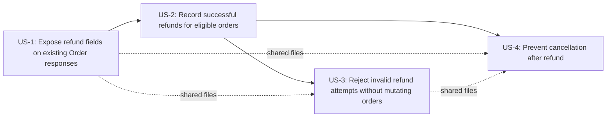

# Plan: Curated Intent (INT-4)

Project type: brownfield. Knowledge graph: consulted.

## Build schedule

Stories in the same wave are built in parallel. A story waits for the stories it depends on, and for earlier stories in the same repo whose planned files overlap its own (CD-05).

- Wave 1: US-1.
- Wave 2: US-2. US-2 waits for US-1 (depends on it).
- Wave 3: US-3. US-3 waits for US-1 (shares `app/main.py`, `app/store.py`, `openapi.yaml`, `tests/**`), US-2 (depends on it).
- Wave 4: US-4. US-4 waits for US-1 (shares `app/main.py`, `app/store.py`, `openapi.yaml`, `tests/**`), US-2 (depends on it), US-3 (shares `app/main.py`, `app/store.py`, `openapi.yaml`, `tests/**`).

## Order

| # | Story | Repo | Wave | Risk | Depends on | Waits for | Protected contract |
| --- | --- | --- | --- | --- | --- | --- | --- |
| 1 | US-1: Expose refund fields on existing Order responses | `SanjulikaSthirAI/orders-api` | 1 | high | - | - | yes |
| 2 | US-2: Record successful refunds for eligible orders | `SanjulikaSthirAI/orders-api` | 2 | high | US-1 | US-1 | yes |
| 3 | US-3: Reject invalid refund attempts without mutating orders | `SanjulikaSthirAI/orders-api` | 3 | high | US-2 | US-1, US-2 | yes |
| 4 | US-4: Prevent cancellation after refund | `SanjulikaSthirAI/orders-api` | 4 | high | US-2 | US-1, US-2, US-3 | yes |

## Dependencies

Solid arrows are dependencies; dotted arrows are shared planned files.

## Stories

### 1. US-1: Expose refund fields on existing Order responses

- **Repo:** `SanjulikaSthirAI/orders-api`
- **Requirements:** FR-9; TDD sections 2.1, 3, 4, 7
- **Risk:** high (changes a protected contract)
- **Depends on:** nothing
- **Build wave:** 1; waits for nothing
- **Touches:** `app/models.py`, `app/store.py`, `app/main.py`, `tests/**`, `openapi.yaml`
- **Provides:** `POST /orders`, `GET /orders/{order_id}`, `GET /orders`, `POST /orders/{order_id}/cancel`; **consumes:** -

Extend the Orders API in-memory order model and response model so newly created, read, listed, and cancelled orders include the additive refund fields with default non-refunded values, without adding refund action behavior yet.

Acceptance criteria:
- AC-9.1: Given a newly created Order has not been refunded, when the create response is returned, then it shows `refunded: false` and `refund_time: null`.
- AC-9.2: Given an Order has not been refunded, when the Order is returned in an existing read response, then it shows `refunded: false` and `refund_time: null`.
- AC-9.3: Given an Order has not been refunded, when the Order is returned in an existing list response, then it shows `refunded: false` and `refund_time: null`.
- AC-9.6: Given an Order is returned in an existing cancellation success response, when the response is returned, then it shows the existing cancelled state alongside `refunded` and `refund_time`.
- AC-9.7: Given an Order is returned in any create, read, list, or cancellation success response, when the response includes cancelled state and refund fields, then it does not show both cancelled state and `refunded: true` for the same Order.

| Test | Verifies | Type | Inputs | Expected |
| --- | --- | --- | --- | --- |
| TC-1.1 Create response includes default refund fields for a new order | AC-9.1 | contract | POST /orders with valid create payload | 201 response body includes refunded=false and refund_time=null for the created order |
| TC-1.2 Read response includes default refund fields for a non-refunded order | AC-9.2 | contract | Existing created order; GET /orders/{order_id} | 200 response body includes refunded=false and refund_time=null |
| TC-1.3 List response includes default refund fields for non-refunded orders | AC-9.3 | contract | Existing created order; GET /orders | 200 response body includes the order with refunded=false and refund_time=null |
| TC-1.4 Cancellation success response includes cancelled state and refund fields | AC-9.6 | contract | Existing non-refunded order; POST /orders/{order_id}/cancel | Success response shows cancelled state plus refunded=false and refund_time=null |
| TC-1.5 Existing order responses never show cancelled and refunded true together before refund action exists | AC-9.7 | integration | POST /orders create response | Response does not contain both cancelled=true and refunded=true for the same order |
|  |  |  | GET /orders/{order_id} for created order | Response does not contain both cancelled=true and refunded=true for the same order |
|  |  |  | GET /orders after creating order | Listed order does not contain both cancelled=true and refunded=true |
|  |  |  | POST /orders/{order_id}/cancel for created order | Cancellation success response does not contain both cancelled=true and refunded=true |

### 2. US-2: Record successful refunds for eligible orders

- **Repo:** `SanjulikaSthirAI/orders-api`
- **Requirements:** FR-1, FR-2, FR-6, FR-9; TDD sections 2.1, 3, 4, 6, 7, 9
- **Risk:** high (changes a protected contract)
- **Depends on:** US-1
- **Build wave:** 2; waits for US-1
- **Touches:** `app/store.py`, `app/main.py`, `tests/**`, `openapi.yaml`
- **Provides:** `POST /orders/{order_id}/refunds`, `GET /orders/{order_id}`, `GET /orders`; **consumes:** -

Add the refund action endpoint and store operation for the successful path, using an injected deterministic processing clock to record refund state and refund time for eligible orders with no required request body.

Acceptance criteria:
- AC-1.1: Given an existing Order that is not a Refunded order, is not a Cancelled order, and has a creation timestamp less than or equal to 30×24 hours before the Refund action processing time, when Support performs the Refund action for that Order ID, then the Order is marked as a Refunded order and the refund time is recorded.
- AC-1.2: Given an existing Order that is not a Refunded order, is not a Cancelled order, and has a creation timestamp less than or equal to 30×24 hours before the Refund action processing time, when Support performs the Refund action for that Order ID, then the response includes the same refund time that is recorded for the Order.
- AC-1.3: Given Support performs the Refund action for an Order ID and supplies a refund time, when the request is processed, then the supplied refund time is not used as the recorded refund time.
- AC-1.4: Given Support performs the Refund action for an Order ID, when the request is sent with only the Order ID and no request body, then the Orders API processes the request.
- AC-2.1: Given an existing Order that is allowed to be refunded, when Support performs the Refund action for that Order ID, then the response includes the Order ID, whether the Order is a Refunded order, and the refund time.
- AC-6.1: Given an existing Order is not a Refunded order, is not a Cancelled order, and the Refund action processing time is earlier than the Order creation timestamp plus 30×24 hours, when Support performs the Refund action for that Order ID, then the Order is marked as a Refunded order and the refund time is recorded.
- AC-6.2: Given an existing Order is not a Refunded order, is not a Cancelled order, and the Refund action processing time is equal to the Order creation timestamp plus 30×24 hours, when Support performs the Refund action for that Order ID, then the Order is marked as a Refunded order and the refund time is recorded.
- AC-9.4: Given an Order has been refunded, when the Order is returned in an existing read response, then it shows `refunded: true` and the recorded refund time.
- AC-9.5: Given an Order has been refunded, when the Order is returned in an existing list response, then it shows `refunded: true` and the recorded refund time.
- AC-9.7: Given an Order is returned in any read, list, or Refund action success response, when the response includes cancelled state and refund fields, then it does not show both cancelled state and `refunded: true` for the same Order.

| Test | Verifies | Type | Inputs | Expected |
| --- | --- | --- | --- | --- |
| TC-2.1 Refunding an eligible order before the cutoff records refund state and time | AC-1.1, AC-6.1 | integration | Order created at processing_time minus 29 days 23:59:59; POST /orders/{order_id}/refunds with no body | Success; later read shows refunded=true and refund_time equals processing_time |
| TC-2.2 Refunding an eligible order at the exact 30 day cutoff succeeds | AC-6.2 | integration | Order created exactly 30*24 hours before processing_time; POST /orders/{order_id}/refunds | Success; later read shows refunded=true and refund_time equals processing_time |
| TC-2.3 Refund response uses the same refund time recorded on the order | AC-1.2 | integration | Eligible order; deterministic processing_time=2026-01-31T12:00:00Z; POST /orders/{order_id}/refunds then GET /orders/{order_id} | Refund response refund_time is 2026-01-31T12:00:00Z and read response refund_time is the same value |
| TC-2.4 Supplied refund time in request body is ignored | AC-1.3 | integration | Eligible order; processing_time=2026-01-31T12:00:00Z; request body refund_time=1999-01-01T00:00:00Z; POST /orders/{order_id}/refunds | Success response and later read record refund_time=2026-01-31T12:00:00Z, not 1999-01-01T00:00:00Z |
| TC-2.5 Refund action accepts a request with only the order ID and no body | AC-1.4 | contract | Eligible order; POST /orders/{order_id}/refunds with empty body/no request body | Success response is returned and order is refunded |
| TC-2.6 Refund success response includes order ID refunded flag and refund time | AC-2.1 | contract | Eligible order; POST /orders/{order_id}/refunds | Success response includes order_id matching the path order, refunded=true, and non-null refund_time |
| TC-2.7 Read response exposes refund information after refund | AC-9.4 | contract | Refunded order; GET /orders/{order_id} | 200 response shows refunded=true and the recorded refund_time |
| TC-2.8 List response exposes refund information after refund | AC-9.5 | contract | Refunded order; GET /orders | 200 response includes the order with refunded=true and the recorded refund_time |
| TC-2.9 Refund success read and list responses do not show an order as both cancelled and refunded | AC-9.7 | integration | Eligible order refunded successfully; inspect refund action success response | Response does not contain both cancelled=true and refunded=true for the same order |
|  |  |  | Eligible order refunded successfully; GET /orders/{order_id} | Read response does not contain both cancelled=true and refunded=true for the same order |
|  |  |  | Eligible order refunded successfully; GET /orders | List response does not contain both cancelled=true and refunded=true for the same order |

### 3. US-3: Reject invalid refund attempts without mutating orders

- **Repo:** `SanjulikaSthirAI/orders-api`
- **Requirements:** FR-3, FR-4, FR-5, FR-6, FR-7; TDD sections 2.1, 3, 4, 7
- **Risk:** high (changes a protected contract)
- **Depends on:** US-2
- **Build wave:** 3; waits for US-1, US-2
- **Touches:** `app/store.py`, `app/main.py`, `tests/**`, `openapi.yaml`
- **Provides:** `POST /orders/{order_id}/refunds`; **consumes:** -

Complete refund rejection behavior for unknown, already refunded, cancelled, and expired-window orders, including the required blocker priority and non-mutation guarantees.

Acceptance criteria:
- AC-3.1: Given no Order exists for the supplied Order ID, when Support performs the Refund action for that Order ID, then a not-found response is returned with Refund reason "order not found".
- AC-3.2: Given no Order exists for the supplied Order ID, when Support performs the Refund action for that Order ID and later requests the same Order ID, then the Order is still not found.
- AC-4.1: Given an Order is already a Refunded order, when Support performs the Refund action for that Order ID, then the Refund is rejected with Refund reason "order already refunded".
- AC-4.2: Given an Order is already a Refunded order, when Support performs the Refund action for that Order ID, then the original refund time remains unchanged in later Order API behavior that returns the Order.
- AC-5.1: Given an Order is a Cancelled order, when Support performs the Refund action for that Order ID, then the Refund is rejected with Refund reason "order cancelled".
- AC-5.2: Given an Order is a Cancelled order, when Support performs the Refund action for that Order ID, then later Order API behavior that returns the Order still shows the Order as cancelled and not a Refunded order.
- AC-6.3: Given an existing Order is not a Refunded order, is not a Cancelled order, and the Refund action processing time is later than the Order creation timestamp plus 30×24 hours, when Support performs the Refund action for that Order ID, then the Refund is rejected with Refund reason "refund window expired".
- AC-6.4: Given an Order is not a Recent order, when Support performs the Refund action for that Order ID, then later Order API behavior that returns the Order shows the Order is not a Refunded order.
- AC-7.1: Given an Order is already a Refunded order and is not a Recent order, when Support performs the Refund action for that Order ID, then the Refund is rejected with Refund reason "order already refunded".
- AC-7.2: Given an Order is a Cancelled order and is not a Recent order, when Support performs the Refund action for that Order ID, then the Refund is rejected with Refund reason "order cancelled".

| Test | Verifies | Type | Inputs | Expected |
| --- | --- | --- | --- | --- |
| TC-3.1 Refunding an unknown order returns not found with order not found reason | AC-3.1 | contract | No order exists for order_id=missing-order; POST /orders/missing-order/refunds | Not-found response with Refund reason 'order not found' |
| TC-3.2 Refunding an unknown order does not create an order | AC-3.2 | integration | No order exists for order_id=missing-order; POST /orders/missing-order/refunds then GET /orders/missing-order | Refund response is not found; later read is still not found |
| TC-3.3 Refunding an already refunded order is rejected with already refunded reason | AC-4.1 | contract | Order already refunded; POST /orders/{order_id}/refunds again | Rejected response with Refund reason 'order already refunded' |
| TC-3.4 Repeated refund leaves original refund time unchanged | AC-4.2 | integration | Order refunded at original_refund_time=2026-01-01T10:00:00Z; second refund attempted at 2026-01-02T10:00:00Z; then GET /orders/{order_id} | Second refund rejected; read response still has refund_time=2026-01-01T10:00:00Z |
| TC-3.5 Refunding a cancelled order is rejected with order cancelled reason | AC-5.1 | contract | Order is cancelled; POST /orders/{order_id}/refunds | Rejected response with Refund reason 'order cancelled' |
| TC-3.6 Refund attempt for cancelled order preserves cancelled non-refunded state | AC-5.2 | integration | Order is cancelled; POST /orders/{order_id}/refunds then GET /orders/{order_id} | Refund rejected; later read shows cancelled=true, refunded=false, and refund_time=null |
| TC-3.7 Refunding an order after the 30 day cutoff is rejected with refund window expired reason | AC-6.3 | contract | Order created 30 days plus 1 second before processing_time; not refunded and not cancelled; POST /orders/{order_id}/refunds | Rejected response with Refund reason 'refund window expired' |
| TC-3.8 Expired-window refund attempt does not mark order as refunded | AC-6.4 | integration | Order created 30 days plus 1 second before processing_time; POST /orders/{order_id}/refunds then GET /orders/{order_id} | Refund rejected; later read shows refunded=false and refund_time=null |
| TC-3.9 Already refunded reason takes priority over expired refund window | AC-7.1 | contract | Order is already refunded and created more than 30 days before processing_time; POST /orders/{order_id}/refunds | Rejected response with Refund reason 'order already refunded' |
| TC-3.10 Cancelled reason takes priority over expired refund window | AC-7.2 | contract | Order is cancelled and created more than 30 days before processing_time; POST /orders/{order_id}/refunds | Rejected response with Refund reason 'order cancelled' |

### 4. US-4: Prevent cancellation after refund

- **Repo:** `SanjulikaSthirAI/orders-api`
- **Requirements:** FR-8, FR-9; TDD sections 2.1, 3, 4, 7
- **Risk:** high (changes a protected contract)
- **Depends on:** US-2
- **Build wave:** 4; waits for US-1, US-2, US-3
- **Touches:** `app/store.py`, `app/main.py`, `tests/**`, `openapi.yaml`
- **Provides:** `POST /orders/{order_id}/cancel`, `GET /orders/{order_id}`; **consumes:** -

Update the existing cancel behavior so refunded orders cannot become cancelled, returning the required conflict reason while preserving refund state.

Acceptance criteria:
- AC-8.1: Given an Order is a Refunded order, when Support attempts to cancel that Order, then the cancel attempt is rejected with reason "order already refunded".
- AC-8.2: Given an Order is a Refunded order, when Support attempts to cancel that Order, then later Order API behavior that returns the Order shows the Order as a Refunded order and not cancelled.
- AC-9.7: Given an Order is returned in read or cancellation behavior, when the response includes cancelled state and refund fields, then it does not show both cancelled state and `refunded: true` for the same Order.

| Test | Verifies | Type | Inputs | Expected |
| --- | --- | --- | --- | --- |
| TC-4.1 Cancelling a refunded order is rejected with already refunded reason | AC-8.1 | contract | Order has been refunded; POST /orders/{order_id}/cancel | Rejected response with reason 'order already refunded' |
| TC-4.2 Failed cancellation after refund preserves refunded and not-cancelled state | AC-8.2 | integration | Order has been refunded; POST /orders/{order_id}/cancel then GET /orders/{order_id} | Cancel rejected; later read shows refunded=true, refund_time unchanged, and cancelled=false |
| TC-4.3 Read and cancellation behavior do not show refunded orders as cancelled | AC-9.7 | integration | Order has been refunded; POST /orders/{order_id}/cancel rejection response | Cancellation behavior does not return the order as both cancelled=true and refunded=true |
|  |  |  | Order has been refunded and cancel was rejected; GET /orders/{order_id} | Read response does not contain both cancelled=true and refunded=true for the same order |
