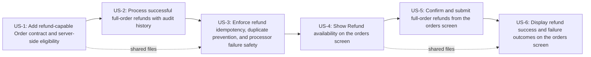

# Plan: refunds-for-orders (INT-5)

Project type: brownfield. Knowledge graph: consulted.

## Build schedule

Stories in the same wave are built in parallel. A story waits for the stories it depends on, and for earlier stories in the same repo whose planned files overlap its own (CD-05).

- Wave 1: US-1.
- Wave 2: US-2. US-2 waits for US-1 (depends on it).
- Wave 3: US-3. US-3 waits for US-1 (shares `app/main.py`, `app/models.py`, `app/store.py`, `openapi.yaml`, `tests/**`), US-2 (depends on it).
- Wave 4: US-4. US-4 waits for US-3 (depends on it).
- Wave 5: US-5. US-5 waits for US-4 (depends on it).
- Wave 6: US-6. US-6 waits for US-4 (shares `api/**`, `app/**`, `config/**`, `format/**`, `tests/**`), US-5 (depends on it).

## Order

| # | Story | Repo | Wave | Risk | Depends on | Waits for | Protected contract |
| --- | --- | --- | --- | --- | --- | --- | --- |
| 1 | US-1: Add refund-capable Order contract and server-side eligibility | `SanjulikaSthirAI/orders-api` | 1 | high | - | - | yes |
| 2 | US-2: Process successful full-order refunds with audit history | `SanjulikaSthirAI/orders-api` | 2 | high | US-1 | US-1 | yes |
| 3 | US-3: Enforce refund idempotency, duplicate prevention, and processor failure safety | `SanjulikaSthirAI/orders-api` | 3 | high | US-2 | US-1, US-2 | yes |
| 4 | US-4: Show Refund availability on the orders screen | `SanjulikaSthirAI/orders-ui` | 4 | high | US-3 | US-3 | yes |
| 5 | US-5: Confirm and submit full-order refunds from the orders screen | `SanjulikaSthirAI/orders-ui` | 5 | high | US-4 | US-4 | yes |
| 6 | US-6: Display refund success and failure outcomes on the orders screen | `SanjulikaSthirAI/orders-ui` | 6 | high | US-5 | US-4, US-5 | yes |

## Dependencies

Solid arrows are dependencies; dotted arrows are shared planned files.

## Stories

### 1. US-1: Add refund-capable Order contract and server-side eligibility

- **Repo:** `SanjulikaSthirAI/orders-api`
- **Requirements:** FR-1; TDD sections 2.1, 3, 5, 7
- **Risk:** high (changes a protected contract)
- **Depends on:** nothing
- **Build wave:** 1; waits for nothing
- **Touches:** `app/models.py`, `app/store.py`, `app/main.py`, `openapi.yaml`, `tests/**`
- **Provides:** `GET /orders`, `GET /orders/{order_id}`; **consumes:** -

Extend the orders API Order representation so authorized Support agents can identify Refund availability and ineligibility from existing order reads before the money-moving endpoint is added.

Acceptance criteria:
- AC-1.1: Given a Support agent with refund permission is viewing an Order that is currently paid, is a Recent order, and has not already been refunded, when the orders screen is shown, then the Refund action is available.
- AC-1.2: Given a Support agent with refund permission is viewing an Order that is not currently paid, when the orders screen is shown, then the Refund action is unavailable with a specific reason that only currently paid Orders can be refunded.
- AC-1.3: Given a Support agent with refund permission is viewing an Order created more than 30 days before the Refund attempt, when the orders screen is shown, then the Refund action is unavailable with a specific reason that only Orders placed in the last 30 days can be refunded.
- AC-1.4: Given a Support agent with refund permission is viewing an Order that has already been refunded, when the orders screen is shown, then the Refund action is unavailable with a specific reason that the Order has already been refunded.

| Test | Verifies | Type | Inputs | Expected |
| --- | --- | --- | --- | --- |
| TC-1.1 GET order exposes refund action available for paid recent non-refunded order to refund-permitted support agent | AC-1.1 | contract | agent_refund_permission=true, order_status=paid, order_created_at=standard_now_minus_30_days, refunded=false | refund.available=true; refund.reason=null or absent |
| TC-1.2 GET order exposes currently-paid ineligibility reason for unpaid order | AC-1.2 | contract | agent_refund_permission=true, order_status=pending, order_created_at=standard_now_minus_1_day, refunded=false | refund.available=false; refund.reason='Only currently paid Orders can be refunded.' |
|  |  |  | agent_refund_permission=true, order_status=cancelled, order_created_at=standard_now_minus_1_day, refunded=false | refund.available=false; refund.reason='Only currently paid Orders can be refunded.' |
| TC-1.3 GET order exposes last-30-days ineligibility reason for non-recent order | AC-1.3 | contract | agent_refund_permission=true, order_status=paid, order_created_at=standard_now_minus_30_days_minus_1_second, refunded=false | refund.available=false; refund.reason='Only Orders placed in the last 30 days can be refunded.' |
| TC-1.4 GET order exposes already-refunded ineligibility reason for refunded order | AC-1.4 | contract | agent_refund_permission=true, order_status=paid, order_created_at=standard_now_minus_1_day, refunded=true | refund.available=false; refund.reason='The Order has already been refunded.' |

### 2. US-2: Process successful full-order refunds with audit history

- **Repo:** `SanjulikaSthirAI/orders-api`
- **Requirements:** FR-2, FR-3, FR-6; TDD sections 2.1, 3, 4, 5, 6, 7
- **Risk:** high (changes a protected contract)
- **Depends on:** US-1
- **Build wave:** 2; waits for US-1
- **Touches:** `app/main.py`, `app/models.py`, `app/store.py`, `openapi.yaml`, `tests/**`
- **Provides:** `POST /orders/{order_id}/refunds`, `POST /orders/{order_id}/cancel`; **consumes:** -

Add the authenticated and authorized refund endpoint, injected RefundProcessor, successful refund state transition, refunded paid-action guards, and internal successful Refund audit/history records.

Acceptance criteria:
- AC-2.2: Given the Refund confirmation is shown, when the Support agent submits the confirmation, then the system attempts to issue a Full-order refund for the full paid Order total exactly as captured on the Order.
- AC-2.4: Given the Refund confirmation is shown, when the Support agent submits the confirmation, then the Support agent is not required to enter a Refund reason.
- AC-3.1: Given a Support agent with refund permission submits confirmation for an Order that is currently paid, is a Recent order, and has not already been refunded, when the Refund completes successfully, then the Order is marked as refunded.
- AC-3.4: Given a Refund completes successfully, when a paid-Order fulfillment action is attempted for that Order, then that action is not completed.
- AC-3.5: Given a Refund completes successfully, when a customer-facing paid-Order action is attempted for that Order, then that action is not completed.
- AC-6.1: Given a Refund completes successfully, when the internal audit/history record is created, then it includes the Support agent, Order ID, refunded amount, and Refund date/time.
- AC-6.2: Given a Refund completes successfully and a processor Refund or transaction reference is available, when the internal audit/history record is created, then it includes that reference.
- AC-6.3: Given a Refund completes successfully, when the internal audit/history record is created, then it does not include Support agent notes.

| Test | Verifies | Type | Inputs | Expected |
| --- | --- | --- | --- | --- |
| TC-2.1 Refund endpoint charges full captured paid order total exactly | AC-2.2 | integration | agent_refund_permission=true, order_id=eligible_paid_recent_order, captured_total=123.45, submit_body_without_reason=true | RefundProcessor receives amount=123.45 exactly for order_id; response indicates completed refund |
| TC-2.2 Refund endpoint accepts confirmation submission without refund reason | AC-2.4 | contract | agent_refund_permission=true, order_id=eligible_paid_recent_order, request_body={} | request is accepted; no validation error for missing reason; refund completes successfully |
| TC-2.3 Successful refund marks order as refunded | AC-3.1 | integration | agent_refund_permission=true, order_status=paid, order_created_at=standard_now_minus_1_day, refunded=false, processor_result=success | POST refund returns success; subsequent GET order has refunded=true/status=refunded |
| TC-2.4 Paid-order fulfillment action is blocked after successful refund | AC-3.4 | integration | order_refunded_by_successful_refund=true, attempted_action=fulfillment_cancel_or_equivalent_paid_order_fulfillment_action | fulfillment action is not completed; order remains refunded |
| TC-2.5 Customer-facing paid-order action is blocked after successful refund | AC-3.5 | integration | order_refunded_by_successful_refund=true, attempted_action=customer_facing_paid_order_action | customer-facing paid-order action is not completed; order remains refunded |
| TC-2.6 Successful refund audit history includes core refund details | AC-6.1 | integration | agent_id=support-agent-1, order_id=order-123, captured_total=123.45, standard_now=2026-01-15T10:30:00Z, processor_result=success | internal audit record includes support_agent=support-agent-1, order_id=order-123, refunded_amount=123.45, refund_datetime=2026-01-15T10:30:00Z |
| TC-2.7 Successful refund audit history includes processor reference when available | AC-6.2 | integration | processor_result=success, processor_reference=rfnd_abc123 | internal audit record includes processor_reference=rfnd_abc123 |
| TC-2.8 Successful refund audit history excludes support agent notes | AC-6.3 | integration | agent_id=support-agent-1, order_id=eligible_paid_recent_order, request_body_contains_notes=false, processor_result=success | internal audit record contains no support_agent_notes/notes field |

### 3. US-3: Enforce refund idempotency, duplicate prevention, and processor failure safety

- **Repo:** `SanjulikaSthirAI/orders-api`
- **Requirements:** FR-4, FR-5; TDD sections 2.1, 3, 4, 5, 6, 7
- **Risk:** high (changes a protected contract)
- **Depends on:** US-2
- **Build wave:** 3; waits for US-1, US-2
- **Touches:** `app/main.py`, `app/models.py`, `app/store.py`, `openapi.yaml`, `tests/**`
- **Provides:** `POST /orders/{order_id}/refunds`; **consumes:** -

Complete refund endpoint failure behavior by requiring Idempotency-Key, replaying successful same-key submissions, rejecting new-key duplicate refunds, and preserving Order and audit state when the processor fails.

Acceptance criteria:
- AC-4.1: Given a Support agent with refund permission submits a Refund confirmation for an Order and that Refund completes successfully, when another Refund submission for the same Order is handled, then the same Order is not refunded a second time.
- AC-4.2: Given one Refund has completed successfully for an Order, when repeated submissions for that same Order are handled, then the Order is shown as refunded.
- AC-5.1: Given a Support agent with refund permission submits confirmation for an Order that is currently paid, is a Recent order, and has not already been refunded, when the Refund attempt fails, then the Order remains unchanged and no successful Refund is recorded for that Order.

| Test | Verifies | Type | Inputs | Expected |
| --- | --- | --- | --- | --- |
| TC-3.1 Duplicate refund submissions do not create a second refund | AC-4.1 | integration | first_submission_idempotency_key=key-1, second_submission_idempotency_key=key-2, order_id=eligible_paid_recent_order, processor_result=success | first submission completes; second submission does not call processor again and does not create second refund/audit record |
| TC-3.2 Repeated refund submissions leave order shown as refunded | AC-4.2 | integration | order_id=eligible_paid_recent_order, first_submission=success, repeated_submission_count=2 | subsequent GET order shows refunded status after each repeated submission |
| TC-3.3 Failed refund attempt leaves order unchanged and records no successful refund | AC-5.1 | integration | agent_refund_permission=true, order_id=eligible_paid_recent_order, processor_result=failure | POST refund returns failure; subsequent GET order remains paid and not refunded; no successful refund audit/history record exists |

### 4. US-4: Show Refund availability on the orders screen

- **Repo:** `SanjulikaSthirAI/orders-ui`
- **Requirements:** FR-1, FR-6; TDD sections 2.2, 3, 5, 7
- **Risk:** high (changes a protected contract)
- **Depends on:** US-3
- **Build wave:** 4; waits for US-3
- **Touches:** `api/**`, `app/**`, `config/**`, `format/**`, `tests/**`
- **Provides:** -; **consumes:** `GET /orders`, `GET /orders/{order_id}`

Consume the committed refund-capable API contract through the UI API client and render Refund action visibility and unavailable reasons on the orders screen without exposing the internal audit/history record.

Acceptance criteria:
- AC-1.1: Given a Support agent with refund permission is viewing an Order that is currently paid, is a Recent order, and has not already been refunded, when the orders screen is shown, then the Refund action is available.
- AC-1.2: Given a Support agent with refund permission is viewing an Order that is not currently paid, when the orders screen is shown, then the Refund action is unavailable with a specific reason that only currently paid Orders can be refunded.
- AC-1.3: Given a Support agent with refund permission is viewing an Order created more than 30 days before the Refund attempt, when the orders screen is shown, then the Refund action is unavailable with a specific reason that only Orders placed in the last 30 days can be refunded.
- AC-1.4: Given a Support agent with refund permission is viewing an Order that has already been refunded, when the orders screen is shown, then the Refund action is unavailable with a specific reason that the Order has already been refunded.
- AC-1.5: Given a Support agent without refund permission is viewing any Order, when the orders screen is shown, then the Refund action is not shown.
- AC-6.4: Given a Refund completes successfully, when the orders screen is shown to a Support agent, then the internal audit/history record is not shown on the orders screen.

| Test | Verifies | Type | Inputs | Expected |
| --- | --- | --- | --- | --- |
| TC-4.1 Orders screen shows Refund action for eligible refundable order | AC-1.1 | integration | api_order.refund.available=true, api_order.status=paid, api_order.refunded=false, user_refund_permission=true | Refund action is visible/enabled on the order row or detail |
| TC-4.2 Orders screen shows currently-paid unavailable reason for unpaid order | AC-1.2 | integration | api_order.refund.available=false, api_order.refund.reason='Only currently paid Orders can be refunded.', user_refund_permission=true | Refund action is unavailable and reason text 'Only currently paid Orders can be refunded.' is shown |
| TC-4.3 Orders screen shows last-30-days unavailable reason for old order | AC-1.3 | integration | api_order.refund.available=false, api_order.refund.reason='Only Orders placed in the last 30 days can be refunded.', user_refund_permission=true | Refund action is unavailable and reason text 'Only Orders placed in the last 30 days can be refunded.' is shown |
| TC-4.4 Orders screen shows already-refunded unavailable reason for refunded order | AC-1.4 | integration | api_order.refund.available=false, api_order.refund.reason='The Order has already been refunded.', user_refund_permission=true | Refund action is unavailable and reason text 'The Order has already been refunded.' is shown |
| TC-4.5 Orders screen hides Refund action from support agent without refund permission | AC-1.5 | integration | user_refund_permission=false, api_order.refund.available=true | Refund action is not rendered |
| TC-4.6 Orders screen does not render internal audit history record | AC-6.4 | integration | api_order includes refunded status/amount/date and internal_audit_history-like fields if present in fixture | orders screen shows refund summary fields only; no support agent, processor reference, audit/history record, or internal history section is rendered |

### 5. US-5: Confirm and submit full-order refunds from the orders screen

- **Repo:** `SanjulikaSthirAI/orders-ui`
- **Requirements:** FR-2, FR-4; TDD sections 2.2, 3, 5, 7
- **Risk:** high (changes a protected contract)
- **Depends on:** US-4
- **Build wave:** 5; waits for US-4
- **Touches:** `api/**`, `app/**`, `config/**`, `format/**`, `tests/**`
- **Provides:** -; **consumes:** `POST /orders/{order_id}/refunds`

Add the confirmation flow for eligible refunds, generate and reuse one Idempotency-Key per confirmed attempt, call the refund endpoint only through the API client, and avoid issuing a request when confirmation is cancelled.

Acceptance criteria:
- AC-2.1: Given a Support agent with refund permission is viewing an Order that is currently paid, is a Recent order, and has not already been refunded, when the Support agent selects Refund, then the system shows a confirmation that the full paid Order total will be refunded.
- AC-2.2: Given the Refund confirmation is shown, when the Support agent submits the confirmation, then the system attempts to issue a Full-order refund for the full paid Order total exactly as captured on the Order.
- AC-2.3: Given the Refund confirmation is shown, when the Support agent closes or cancels the confirmation without submitting it, then no Refund is issued and the Order remains unchanged.
- AC-2.4: Given the Refund confirmation is shown, when the Support agent submits the confirmation, then the Support agent is not required to enter a Refund reason.
- AC-4.1: Given a Support agent with refund permission submits a Refund confirmation for an Order and that Refund completes successfully, when another Refund submission for the same Order is handled, then the same Order is not refunded a second time.

| Test | Verifies | Type | Inputs | Expected |
| --- | --- | --- | --- | --- |
| TC-5.1 Selecting Refund opens confirmation with full paid order total | AC-2.1 | integration | order_id=order-123, refund.available=true, paid_total=123.45, user_clicks=Refund | confirmation dialog is shown with text indicating full paid order total 123.45 will be refunded |
| TC-5.2 Submitting confirmation calls refund API for full captured order total | AC-2.2 | integration | order_id=order-123, paid_total=123.45, confirmation_submitted=true | API client submit refund is called for order_id=order-123 with idempotency key; UI does not request or send an override amount |
| TC-5.3 Cancelling confirmation does not issue refund and leaves order display unchanged | AC-2.3 | integration | order_id=order-123, paid_total=123.45, confirmation_shown=true, user_action=cancel | refund API client is not called; order still displays original paid/not-refunded state |
| TC-5.4 Submitting confirmation does not require refund reason | AC-2.4 | integration | confirmation_shown=true, reason_field_absent_or_empty=true, user_action=submit | refund API client is called; no validation message requires a refund reason |
| TC-5.5 Confirmed attempt reuses one idempotency key to avoid duplicate refunding on retry | AC-4.1 | integration | order_id=order-123, same_confirmed_attempt_retry_count=2 | all API client calls for the same confirmed attempt use the same Idempotency-Key value |

### 6. US-6: Display refund success and failure outcomes on the orders screen

- **Repo:** `SanjulikaSthirAI/orders-ui`
- **Requirements:** FR-3, FR-4, FR-5, FR-6; TDD sections 2.2, 3, 5, 7
- **Risk:** high (changes a protected contract)
- **Depends on:** US-5
- **Build wave:** 6; waits for US-4, US-5
- **Touches:** `api/**`, `app/**`, `config/**`, `format/**`, `tests/**`
- **Provides:** -; **consumes:** `POST /orders/{order_id}/refunds`, `GET /orders`, `GET /orders/{order_id}`

Update the orders screen after refund completion to show refunded state, amount, date/time, and approved success or failure messages while excluding audit/history records and sensitive details from Refund messages.

Acceptance criteria:
- AC-3.2: Given a Refund completes successfully, when the orders screen is shown to a Support agent, then it shows refunded status, refunded amount, and Refund date/time.
- AC-3.3: Given a Refund completes successfully, when the result is shown to the Support agent, then the message says that the Refund completed and that the full paid Order total was refunded.
- AC-4.2: Given one Refund has completed successfully for an Order, when repeated submissions for that same Order are handled, then the Order is shown as refunded.
- AC-5.2: Given a Refund attempt fails, when the result is shown to the Support agent, then the message says “The refund could not be completed. Please try again.”
- AC-6.4: Given a Refund completes successfully, when the orders screen is shown to a Support agent, then the internal audit/history record is not shown on the orders screen.

| Test | Verifies | Type | Inputs | Expected |
| --- | --- | --- | --- | --- |
| TC-6.1 Orders screen shows refunded status amount and date time after success | AC-3.2 | integration | refund_api_result=success, refreshed_api_order.status=refunded, refunded_amount=123.45, refunded_at=2026-01-15T10:30:00Z | orders screen shows refunded status, 123.45 refunded amount, and formatted refund date/time for 2026-01-15T10:30:00Z |
| TC-6.2 Refund success result message says completed and full paid total refunded | AC-3.3 | integration | refund_api_result=success, paid_total=123.45 | message says refund completed and full paid order total 123.45 was refunded |
| TC-6.3 Repeated refund submission outcome keeps order displayed as refunded | AC-4.2 | integration | repeat_refund_submission_result=already_refunded_or_replayed_success, refreshed_api_order.status=refunded, refunded_amount=123.45 | orders screen shows refunded status and refunded amount |
| TC-6.4 Refund failure result shows approved retry message | AC-5.2 | integration | refund_api_result=failure | message exactly 'The refund could not be completed. Please try again.' |
| TC-6.5 Orders screen excludes audit history after refund success | AC-6.4 | integration | refreshed_api_order includes refunded status/amount/date and audit/history-like internal fields in fixture | orders screen does not show internal audit/history record, support agent, processor reference, notes, or audit section |
