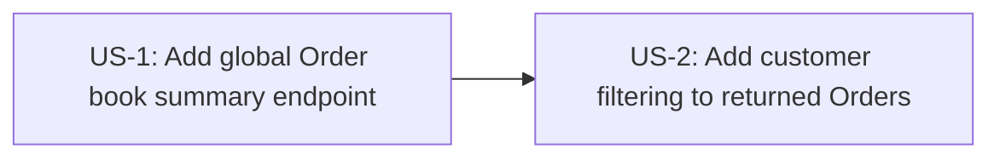

# Plan: Business outcome (INT-6)

Project type: brownfield. Knowledge graph: consulted.

## Build schedule

Stories in the same wave are built in parallel. A story waits for the stories it depends on, and for earlier stories in the same repo whose planned files overlap its own (CD-05).

- Wave 1: US-1.
- Wave 2: US-2. US-2 waits for US-1 (depends on it).

## Order

| # | Story | Repo | Wave | Risk | Depends on | Waits for | Protected contract |
| --- | --- | --- | --- | --- | --- | --- | --- |
| 1 | US-1: Add global Order book summary endpoint | `SanjulikaSthirAI/orders-api` | 1 | high | - | - | yes |
| 2 | US-2: Add customer filtering to returned Orders | `SanjulikaSthirAI/orders-api` | 2 | high | US-1 | US-1 | yes |

## Dependencies

Solid arrows are dependencies; dotted arrows are shared planned files.

## Stories

### 1. US-1: Add global Order book summary endpoint

- **Repo:** `SanjulikaSthirAI/orders-api`
- **Requirements:** FR-1, FR-2, FR-3; TDD sections 2.1, 3, 4, 5, 6, 7
- **Risk:** high (changes a protected contract)
- **Depends on:** nothing
- **Build wave:** 1; waits for nothing
- **Touches:** `app/models.py`, `app/store.py`, `app/main.py`, `openapi.yaml`, `tests/**/*`
- **Provides:** `GET /orders/summary`; **consumes:** -

Add store-level summary calculation, response models, route handling, deterministic tests, and regenerated OpenAPI contract for GET /orders/summary. The summary is global across all existing Orders and returns status counts plus Non-cancelled total value without adding storage, authentication, pagination, or logging customer data.

Acceptance criteria:
- AC-1.1: Given existing Orders in the Order book, when a Support lead requests the Order book summary, then the response includes counts for placed, shipped, delivered and cancelled Orders across all existing Orders.
- AC-1.2: Given no existing Orders, when a Support lead requests the Order book summary, then the response includes placed, shipped, delivered and cancelled counts of 0 and a Non-cancelled total value of 0 cents.
- AC-1.3: Given existing Orders in the Order book and any Customer filter or Order status filter used for returned Orders, when a Support lead requests the Order book summary, then the Order book summary is calculated across all existing Orders without applying those filters.
- AC-2.1: Given there are no Orders for one or more of placed, shipped, delivered or cancelled, when a Support lead requests the Order book summary, then the response still includes each absent Order status with a count of 0.
- AC-2.2: Given an Order has Order status placed, shipped, delivered or cancelled, when a Support lead requests the Order book summary, then that Order contributes 1 to the matching Order status count.
- AC-2.3: Given an Order has Order status outside placed, shipped, delivered and cancelled, when a Support lead requests the Order book summary, then that Order does not contribute to any Order status count.
- AC-3.1: Given existing Orders with Order status placed, shipped or delivered, when a Support lead requests the Order book summary, then the Non-cancelled total value equals the sum of their full stored values in cents.
- AC-3.2: Given existing Orders with Order status cancelled, when a Support lead requests the Order book summary, then cancelled Orders do not contribute to the Non-cancelled total value.
- AC-3.3: Given an Order has an Order status outside placed, shipped, delivered and cancelled, when a Support lead requests the Order book summary, then that Order does not contribute to the Non-cancelled total value.
- AC-3.4: Given an Order with Order status placed, shipped or delivered has a missing or null stored value, when a Support lead requests the Order book summary, then that Order contributes 0 cents to the Non-cancelled total value.
- AC-3.5: Given an Order with Order status placed, shipped or delivered has a negative stored value, when a Support lead requests the Order book summary, then that Order contributes the negative value exactly as stored to the Non-cancelled total value.

| Test | Verifies | Type | Inputs | Expected |
| --- | --- | --- | --- | --- |
| TC-1.1 GET /orders/summary returns global status counts and non-cancelled total for existing orders | AC-1.1, AC-2.2, AC-3.1, AC-3.2 | integration | orders=[{status=placed,value_cents=1000},{status=shipped,value_cents=2500},{status=delivered,value_cents=4000},{status=cancelled,value_cents=9999},{status=placed,value_cents=500}] | HTTP 200; counts={placed:2,shipped:1,delivered:1,cancelled:1}; non_cancelled_total_value_cents=8000 |
| TC-1.2 GET /orders/summary returns zero counts and zero total when order book is empty | AC-1.2, AC-2.1 | integration | orders=[] | HTTP 200; counts={placed:0,shipped:0,delivered:0,cancelled:0}; non_cancelled_total_value_cents=0 |
| TC-1.3 GET /orders/summary is not affected by order retrieval customer or status filters | AC-1.3 | integration | orders=[{status=placed,value_cents=1000,customer=Alice},{status=shipped,value_cents=2000,customer=Bob},{status=cancelled,value_cents=3000,customer=Alice}]; prior_or_parallel_get_orders_filters={customer=Alice,status=placed} | GET /orders/summary HTTP 200; counts={placed:1,shipped:1,delivered:0,cancelled:1}; non_cancelled_total_value_cents=3000 |
| TC-1.4 GET /orders/summary includes absent supported statuses with zero counts | AC-2.1 | integration | orders=[{status=placed,value_cents=1000}] | HTTP 200; counts={placed:1,shipped:0,delivered:0,cancelled:0}; non_cancelled_total_value_cents=1000 |
| TC-1.5 GET /orders/summary excludes unsupported statuses from counts and total | AC-2.3, AC-3.3 | integration | orders=[{status=placed,value_cents=1000},{status=returned,value_cents=7000},{status=pending,value_cents=3000}] | HTTP 200; counts={placed:1,shipped:0,delivered:0,cancelled:0}; non_cancelled_total_value_cents=1000 |
| TC-1.6 GET /orders/summary treats missing or null non-cancelled stored values as zero | AC-3.4 | integration | orders=[{status=placed,value_cents=null},{status=shipped,value_cents=MISSING},{status=delivered,value_cents=250}] | HTTP 200; counts={placed:1,shipped:1,delivered:1,cancelled:0}; non_cancelled_total_value_cents=250 |
| TC-1.7 GET /orders/summary includes negative non-cancelled stored values exactly | AC-3.5 | integration | orders=[{status=placed,value_cents=-150},{status=shipped,value_cents=500}] | HTTP 200; counts={placed:1,shipped:1,delivered:0,cancelled:0}; non_cancelled_total_value_cents=350 |
| TC-1.8 OpenAPI documents GET /orders/summary response schema with all status counts and non-cancelled total | AC-1.1, AC-1.2, AC-2.1, AC-3.1 | contract | openapi.yaml for GET /orders/summary | Path GET /orders/summary exists; successful response schema requires counts for placed, shipped, delivered, cancelled and non_cancelled_total_value_cents as integer cents |

### 2. US-2: Add customer filtering to returned Orders

- **Repo:** `SanjulikaSthirAI/orders-api`
- **Requirements:** FR-4, FR-5; TDD sections 2.1, 3, 4, 5, 6, 7
- **Risk:** high (changes a protected contract)
- **Depends on:** US-1
- **Build wave:** 2; waits for US-1
- **Touches:** `app/store.py`, `app/main.py`, `openapi.yaml`, `tests/**/*`
- **Provides:** `GET /orders`; **consumes:** -

Extend the existing GET /orders implementation with an optional customer query parameter, update store filtering to trim and exact-match Customer name while preserving existing status-filter behavior, add deterministic tests, and regenerate OpenAPI contract version 1.1.0 with the additive parameter.

Acceptance criteria:
- AC-4.1: Given Orders with stored Customer names, when a Support lead requests Orders with a non-blank Customer filter, then the response includes only Orders whose stored Customer name exactly matches the trimmed Customer filter value with the same letter casing.
- AC-4.2: Given an Order with Customer name `Alice`, when a Support lead requests Orders with Customer filter value ` Alice `, then the Order is included in the response.
- AC-4.3: Given an Order with Customer name `Alice`, when a Support lead requests Orders with Customer filter value `alice`, then the Order is not included in the response.
- AC-4.4: Given a non-blank Customer filter and no matching Orders, when a Support lead requests Orders, then the system returns a successful response with no Orders.
- AC-4.5: Given Orders with missing or null Customer names, when a Support lead requests Orders with a non-blank Customer filter, then those Orders are not included in the response.
- AC-4.6: Given Orders with missing or null Customer names that are returned when no Customer filter is applied, when a Support lead requests Orders without a Customer filter, then those Orders remain in the response.
- AC-4.7: Given a blank or whitespace-only Customer filter value, when a Support lead requests Orders, then no Customer filter is applied.
- AC-5.1: Given both a non-blank Customer filter and an Order status filter are provided, when a Support lead requests Orders, then the response includes only Orders matching both the trimmed exact Customer name and the requested Order status.
- AC-5.2: Given only an Order status filter is provided, when a Support lead requests Orders, then only the Order status filter is applied.
- AC-5.3: Given no Customer filter is provided, when a Support lead requests Orders, then no Customer filter is applied.

| Test | Verifies | Type | Inputs | Expected |
| --- | --- | --- | --- | --- |
| TC-2.1 GET /orders with non-blank customer returns only exact case-sensitive customer matches after trimming | AC-4.1 | integration | orders=[{id=o1,customer=Alice,status=placed},{id=o2,customer=Bob,status=placed},{id=o3,customer=Alice,status=shipped}]; query={customer=Alice} | HTTP 200; returned_order_ids=[o1,o3] |
| TC-2.2 GET /orders trims leading and trailing spaces from customer filter | AC-4.2 | integration | orders=[{id=o1,customer=Alice,status=placed},{id=o2,customer=Bob,status=placed}]; query={customer=' Alice '} | HTTP 200; returned_order_ids=[o1] |
| TC-2.3 GET /orders customer filter is case-sensitive | AC-4.3 | integration | orders=[{id=o1,customer=Alice,status=placed}]; query={customer=alice} | HTTP 200; returned_order_ids=[] |
| TC-2.4 GET /orders with non-blank customer and no matches succeeds with empty orders | AC-4.4 | integration | orders=[{id=o1,customer=Alice,status=placed}]; query={customer=Charlie} | HTTP 200; returned_order_ids=[] |
| TC-2.5 GET /orders excludes missing or null customer names when non-blank customer filter is provided | AC-4.5 | integration | orders=[{id=o1,customer=null,status=placed},{id=o2,customer=MISSING,status=shipped},{id=o3,customer=Alice,status=delivered}]; query={customer=Alice} | HTTP 200; returned_order_ids=[o3] |
| TC-2.6 GET /orders without customer filter returns orders with missing or null customer names | AC-4.6, AC-5.3 | integration | orders=[{id=o1,customer=null,status=placed},{id=o2,customer=MISSING,status=shipped},{id=o3,customer=Alice,status=delivered}]; query={} | HTTP 200; returned_order_ids=[o1,o2,o3] |
| TC-2.7 GET /orders treats blank or whitespace-only customer filter as no customer filter | AC-4.7 | integration | orders=[{id=o1,customer=Alice,status=placed},{id=o2,customer=Bob,status=shipped},{id=o3,customer=null,status=delivered}]; query={customer='   '} | HTTP 200; returned_order_ids=[o1,o2,o3] |
|  |  |  | orders=[{id=o1,customer=Alice,status=placed},{id=o2,customer=Bob,status=shipped},{id=o3,customer=null,status=delivered}]; query={customer=''} | HTTP 200; returned_order_ids=[o1,o2,o3] |
| TC-2.8 GET /orders with customer and status filters returns only orders matching both | AC-5.1 | integration | orders=[{id=o1,customer=Alice,status=placed},{id=o2,customer=Alice,status=shipped},{id=o3,customer=Bob,status=placed}]; query={customer=' Alice ',status=placed} | HTTP 200; returned_order_ids=[o1] |
| TC-2.9 GET /orders with only status filter applies only status filter | AC-5.2 | integration | orders=[{id=o1,customer=Alice,status=placed},{id=o2,customer=Bob,status=placed},{id=o3,customer=Alice,status=shipped}]; query={status=placed} | HTTP 200; returned_order_ids=[o1,o2] |
| TC-2.10 OpenAPI documents optional customer query parameter on GET /orders without removing status filter | AC-4.1, AC-5.1, AC-5.2, AC-5.3 | contract | openapi.yaml for GET /orders | GET /orders has optional customer query parameter; existing optional status query parameter remains documented; successful response schema for returned orders remains compatible |
